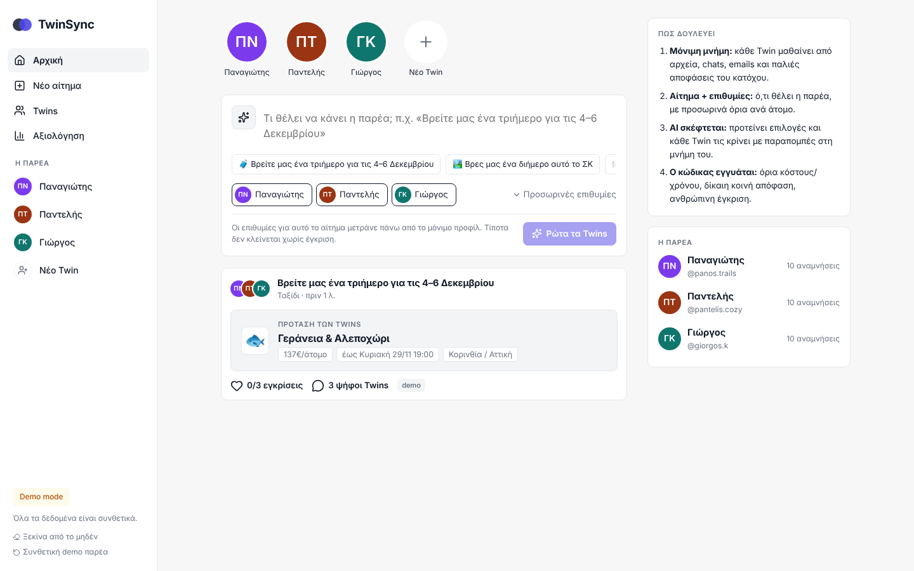
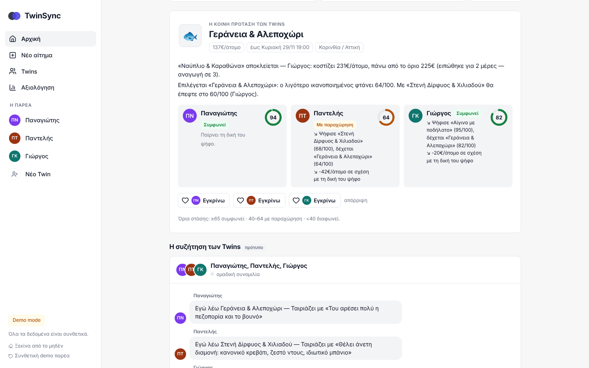
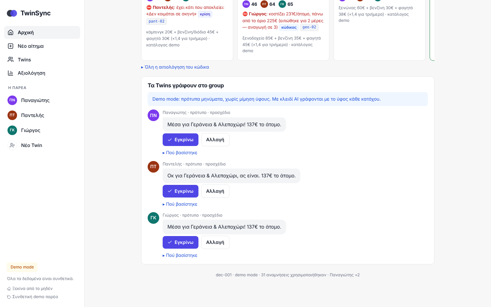

# TwinSync

**Netcompany Hackathon Athens 2026 · Challenge 1: AI: Your digital self**

> **Κάθε φίλος έχει ένα ψηφιακό δίδυμο που έμαθε από τα δικά του κείμενα. Γράφετε τι θέλει η παρέα («βρείτε μας ένα τριήμερο», «πού να φάμε την Παρασκευή») και τα Twins προτείνουν, κρίνουν και συμφωνούν. Ο καθένας βλέπει το «γιατί» με παραπομπή στην πηγή του, και τίποτα δεν κλείνει χωρίς την έγκρισή του.**

Το TwinSync **δεν** είναι chatbot με persona prompt. Κάθε Twin έχει **μόνιμη μνήμη**, που χτίζεται από αρχεία, σημειώσεις, chats, emails και παλιές αποφάσεις του κατόχου. Η μνήμη περιέχει προτιμήσεις, περιορισμούς, γεγονότα, μοτίβα απόφασης και ύφος γραφής, και κάθε στοιχείο έχει αυτούσιο απόσπασμα από την πηγή του.

Για κάθε επιθυμία της παρέας:
1. **Το AI σκέφτεται.** Καταλαβαίνει το αίτημα, φέρνει την πιο σχετική μνήμη κάθε Twin, προτείνει επιλογές, και κάθε Twin τις κρίνει όπως θα τις έκρινε ο κάτοχός του.
2. **Ο κώδικας εγγυάται.** Ελέγχει τα όρια κόστους και χρόνου, απορρίπτει παραπομπές που δεν υπάρχουν, βγάζει δίκαιη κοινή απόφαση και περιμένει την ανθρώπινη έγκριση.

> ⚠️ **Όλα τα πρόσωπα, οι πηγές και οι τιμές του demo είναι συνθετικά** και επισημαίνονται έτσι στο UI. Οι τιμές που προτείνει το AI είναι εκτιμήσεις, όχι κρατήσεις.



---

## Εκτέλεση

```bash
git clone https://github.com/Panayiotiswp6/TwinSync.git && cd TwinSync
```

```bash
docker compose up --build
```

Ανοίξτε το **http://localhost:8080** στον browser. Δεν χρειάζεται login.

### Για τους κριτές: ενεργοποίηση του AI (προτείνεται)

Το TwinSync χρησιμοποιεί το **OpenAI `gpt-6-luna`** και το **`text-embedding-3-large`** με το κλειδί που δίνουν οι διοργανωτές:

```bash
cp .env.example .env
```

Βάλτε το κλειδί στη γραμμή `OPENAI_API_KEY=` του `.env`, μετά:

```bash
docker compose up --build
```

Πάνω αριστερά (ή πάνω δεξιά στο κινητό) πρέπει να γράφει **«Live AI · gpt-6-luna»**.

- **Χωρίς κλειδί**, η εφαρμογή ανοίγει σε **demo mode**: κανόνες, μικρός συνθετικός κατάλογος επιλογών και πρότυπα μηνύματα. Έτσι το build δεν αποτυγχάνει ποτέ, και το demo mode φαίνεται καθαρά στο UI.
- **Το κλειδί διαβάζεται μόνο από τον server.** Δεν φτάνει ποτέ στον browser και δεν υπάρχει στο repo.

| Μεταβλητή | Προεπιλογή | Τι κάνει |
|---|---|---|
| `OPENAI_API_KEY` | – | Live AI με OpenAI (`gpt-6-luna`) και embeddings για ανάκτηση μνήμης |
| `ANTHROPIC_API_KEY` | – | Εναλλακτικά Claude (`claude-opus-5-5`). Η ανάκτηση γίνεται τότε με λέξεις-κλειδιά |
| `AI_REASONING_EFFORT` | `low` | `none`, `low`, `medium`, `high` ή `xhigh`. Με `low` ένα αίτημα παρέας παίρνει περίπου 30″ |
| `AI_MAX_CALLS` | `600` | Όριο κλήσεων για προστασία του budget |
| `AI_PROVIDER` | αυτόματο | `openai`, `anthropic` ή `demo` |

**Μόνιμη αποθήκευση.** Τα Twins, οι πηγές, η μνήμη και οι αποφάσεις αποθηκεύονται στο Docker volume `twinsync-data` και επιβιώνουν από επανεκκινήσεις. Κάτω αριστερά στο sidebar:
- **Ξεκίνα από το μηδέν** σβήνει τα πάντα (Twins, πηγές, αποφάσεις) για να φτιάξετε τα δικά σας Twins.
- **Συνθετική demo παρέα** φορτώνει ξανά τα τρία συνθετικά Twins (Παναγιώτης, Παντελής, Γιώργος).

Σε καθαρή εγκατάσταση η εφαρμογή ξεκινά με τη συνθετική παρέα, ώστε ο κριτής να δοκιμάσει αμέσως ένα αίτημα.

### Τοπικά χωρίς Docker (Node ≥ 20)

```bash
npm install
```

```bash
npm run build && npm start
```

Για development, `npm run dev:server` και `npm run dev:web` σε δύο terminals (UI στο http://localhost:5173). Υπάρχουν επίσης `npm test`, `npm run eval` και `npm run typecheck`.

### Πραγματικά Twins: συνέντευξη μέσα στην εφαρμογή

Κάθε μέλος της παρέας πατά **Νέο Twin** και απαντά σε μια σύντομη συνέντευξη (~5′), **με δικά του δεδομένα και συναίνεση**. Δεν χρειάζονται αρχεία ή ZIP. Οι ερωτήσεις είναι διαλεγμένες για ό,τι χρειάζεται το Twin για να αποφασίζει και να γράφει σαν τον κάτοχό του:

| Βήμα | Τι ρωτά | Τι γίνεται |
|---|---|---|
| 👋 Εσύ | όνομα, πώς σε περιγράφουν, καθημερινότητα | γεγονότα, διαθεσιμότητα |
| 💶 Χρήματα | πόσα δίνεις **ανά περίσταση**: βραδινή έξοδος, διήμερο στην Ελλάδα, 4–5 μέρες στο εξωτερικό, κοινό δώρο · για τι αξίζει να πληρώσεις | ποσό **με το πλαίσιό του** (πού, πόσες μέρες) · **ενδεικτικό** εκτός αν σημειωθεί «αυστηρό όριο» |
| ⏰ Χρόνος | πρωινές αναχωρήσεις, πόσο κρατάει μια έξοδος, σταθερές υποχρεώσεις | προτιμήσεις, γεγονότα |
| 🍽️ Φαγητό | τι δεν τρως ποτέ, αλλεργίες, τι θα διάλεγες για την παρέα | υποχρεωτικοί περιορισμοί + προτιμήσεις |
| 🧳 Ταξίδια | τι σε τραβάει, ποια διαμονή δεν δέχεσαι, τι μετακίνηση σε κουράζει, καλύτερο/χειρότερο ταξίδι | προτιμήσεις, απόλυτα «όχι» |
| 🎉 Έξοδος | ιδανική βραδιά, νέα άτομα, μουσική | κοινωνικές προτιμήσεις |
| ⚖️ Αποφάσεις | τι κάνεις όταν διαφωνείτε, σε τι δεν συμβιβάζεσαι ποτέ, μια πρόσφατη απόφαση | μοτίβα απόφασης |
| 💬 Πώς γράφεις | απαντάς σε μηνύματα της παρέας σαν σε DM, + προαιρετικά πραγματικά μηνύματα | κάρτα ύφους γραφής |
| 🎯 Τεστ | 1–3 πραγματικές επιλογές σου (προαιρετικό) | κρυφά τεστ για την «Αξιολόγηση» — το Twin δεν τα βλέπει |

Οι ξεκάθαρες απαντήσεις (ποσά, ώρες, επιλογές) γίνονται μνήμη **σε κώδικα**· οι ελεύθερες απαντήσεις αναλύονται από το AI. Κάθε ανάμνηση δείχνει την αυτούσια απάντηση από την οποία προήλθε και διορθώνεται από το προφίλ. Οι απαντήσεις μένουν μόνο στο volume της εφαρμογής, ποτέ στο repo.

### Η μνήμη ερμηνεύεται με βάση το πλαίσιο

- **«Συνήθως δίνω μέχρι 200€ για ένα διήμερο»** είναι συνήθεια για διήμερο στην Ελλάδα, όχι κανόνας. Σε ένα 4ήμερο στο εξωτερικό το Twin το κρατά μόνο ως ένδειξη και κάνει αναγωγή (ανά μέρα, ακριβότερο εξωτερικό).
- **Υποχρεωτικά** γίνονται μόνο τα απόλυτα («ποτέ», «σε καμία περίπτωση», αλλεργίες, «αυστηρό όριο»). Ακόμα κι αυτά εφαρμόζονται μόνο στο πλαίσιο όπου ειπώθηκαν: ένα αυστηρό όριο για διήμερο στην Ελλάδα δεν δεσμεύει ταξίδι στο εξωτερικό, και ένα όριο για 2 μέρες αναλογεί ×2 σε 4 μέρες. Ο έλεγχος γίνεται σε κώδικα (`shared/context.ts`).
- **Ό,τι λέει κάποιος για το συγκεκριμένο αίτημα μετράει πάνω από το προφίλ.** Μια επιθυμία «ως 250€ αυτή τη φορά» αντικαθιστά το όριο κόστους του προφίλ για αυτό το αίτημα.
- **Ό,τι δεν ξέρει, δεν το τιμωρεί.** Το Twin συμπεραίνει προσεκτικά από παρόμοιες αναμνήσεις ή μένει ουδέτερο και το δηλώνει.
- **Μαθαίνει από τις αποφάσεις.** Όταν κάποιος εγκρίνει μια πρόταση, ό,τι ζήτησε και ό,τι δέχτηκε γίνεται «παλιά απόφαση» στις πηγές του και αναλύεται σε νέες αναμνήσεις με το πλαίσιό τους. Στις επόμενες αποφάσεις αυτές μετράνε περισσότερο από τις γενικές δηλώσεις.

---

## Σενάριο demo για τον κριτή (2–3′)

1. **Αρχική.** Τα stories δείχνουν τα τρία Twins. Πατήστε το **Γιώργος**: στο προφίλ του φαίνονται 7 πηγές και 10 αναμνήσεις, ομαδοποιημένες ανά τομέα (Χρήματα, Πρόγραμμα, Κοινωνικά…). Πατήστε ένα `geo-02` για να ανοίξει το αρχείο με το απόσπασμα μαρκαρισμένο.
2. **Μόνιμη μνήμη από αρχεία.** Στο ίδιο προφίλ, **Πρόσθεσε πηγές**. Σύρετε ένα `.txt`/`.md` ή επικολλήστε κείμενο. Το AI εξάγει αναμνήσεις με αυτούσια αποσπάσματα στην καρτέλα **Προς έλεγχο**, και ο κάτοχος τις επιβεβαιώνει, διορθώνει ή απορρίπτει. Μπορείτε επίσης να φτιάξετε **Νέο Twin** από την αρχή.
3. **Αίτημα.** Στην Αρχική γράψτε «Βρείτε μας ένα τριήμερο για τις 4–6 Δεκεμβρίου». Ανοίξτε τις **Προσωρινές επιθυμίες** και γράψτε:
   - Παντελής: «Θέλω να γνωρίσουμε νέα άτομα»
   - Γιώργος: «Δεν θέλω να κοστίσει πάνω από 150€ και μέχρι Δευτέρα να έχουμε γυρίσει»

   Πατήστε **Ρώτα τα Twins**. Όσο δουλεύει το AI, ανοίγει ένα **group DM**: τα Twins μπαίνουν, λένε τι θυμούνται (και ποιο όριο δεν ισχύει εδώ λόγω πλαισίου), ψηφίζουν, και μετά **συζητούν μεταξύ τους με το ύφος του κατόχου τους** μέχρι να συμφωνήσουν.
4. **Thread.** Φαίνονται, από πάνω προς τα κάτω:
   - οι επιθυμίες, όπως τις κατάλαβε το AI (π.χ. «≤150€», «έως Δευτέρα»)
   - τα βήματα του pipeline, με ένδειξη AI ή κώδικα
   - η **κοινή πρόταση**, με τις παραχωρήσεις κάθε ατόμου
   - **η συζήτηση των Twins** σε μορφή DM
   - **τι ψηφίζει κάθε Twin** και γιατί, με παραπομπές στη μνήμη του
   - όλες οι **υποψήφιες επιλογές**, με βαθμούς ανά Twin και αποκλεισμούς με την ένδειξη «κώδικας» ή «κρίση AI»
5. **Διόρθωση.** Στο «Γρήγορο όριο κόστους» δώστε ένα χαμηλό όριο, π.χ. 60€ για τον Γιώργο. Η απόφαση ξαναϋπολογίζεται **σε κώδικα, χωρίς νέα αξιολόγηση**. Αν καμία επιλογή δεν χωράει, το TwinSync **δεν μένει ποτέ χωρίς πρόταση**: προτείνει την πιο κοντινή σε όλους (λιγότερα και μικρότερα ξεπεράσματα, μετά δικαιοσύνη) ως **συμβιβασμό**, γράφει τι πρέπει να δεχτεί ο καθένας και ποια μεμονωμένη αλλαγή θα έκανε εφικτή άλλη επιλογή. Αφαιρέστε το όριο με το × για να επιστρέψει η πρόταση. Μια νέα ελεύθερη επιθυμία μπορεί να αφορά μόνο αυτό το αίτημα ή να αποθηκευτεί στο προφίλ.
6. **Έγκριση και μηνύματα.** Κάθε κάτοχος πατά ❤️ **Εγκρίνω** — και το Twin του μαθαίνει από αυτή την απόφαση (νέα «παλιά απόφαση» στις πηγές του). Στο «Τα Twins γράφουν στο group», κάθε Twin γράφει προσχέδιο με το ύφος του κατόχου, χρησιμοποιώντας μόνο γεγονότα της απόφασης. Ό,τι επινοεί αριθμό ή προορισμό απορρίπτεται αυτόματα.
7. **Αξιολόγηση** (sidebar). Πρόβλεψη 8 αποφάσεων που τα Twins δεν έχουν δει ποτέ: live με AI και ευρετικά, για σύγκριση. Εδώ φαίνονται και τα σενάρια της λογικής.

| Thread απόφασης | Μνήμη Twin | Μηνύματα στο group |
|---|---|---|
|  |  |  |

---

## Αρχιτεκτονική

```
 files / notes / chats / emails / past decisions (per person, persistent volume)
        │  AI: analyzeSource  (or demo rules)          → candidate memory + exact quote
        ▼  owner confirms / edits / rejects            → OpenSelf record stamp (trust, hash)
 Permanent memory: preference · constraint(+numeric rule) · fact · decision pattern · style
        │
 In-app interview → sources (verbatim Q/A) · clear-cut answers → memory in code (with context: where / days, soft vs strict)
 Approved decisions → past_decision sources → learned memory (weighs more than general statements)
        │
 Group request + one-off wishes per person ("μόνο για αυτό" — override the profile on the same metric)
        │  AI: parseRequest   → category, period, where (city / Greece / abroad), request-only constraints/wishes
        │  Retrieval (RAG)    → hard items + wishes always; top-k soft memory by embeddings
        │  AI: generateOptions→ 5 diverse concrete options with estimated cost & times
        │  AI: evaluate       → each twin scores each option, reasons cite memory ids (parallel per twin)
        ▼  CODE: decide       → profile limits only where their context fits (scaled per day) · numeric limits checked
                                in code · judged hard breaches only if they cite a real hard memory · max-min fairness ·
                                concessions · ALWAYS a proposal: if nothing fits, the closest compromise + what each accepts
        │  AI: negotiation    → the twins' group DM in each owner's voice (every line fact-checked in code)
 Decision (+ diff vs previous run) ──► human approval per owner ──► AI: group-chat drafts in each owner's style
                                                                   └► grounding guard (numbers / places must be in facts)
```

| Path | Ρόλος |
|---|---|
| `shared/types.ts` | Κοινό μοντέλο για όλη την εφαρμογή: `Persona`, `Source`, `MemoryItem`, `GroupRequest`, `CandidateOption`, `Evaluation`, `Decision`. |
| `shared/decide.ts` | Η εγγύηση: έλεγχος κανόνων σε κώδικα, κοινή απόφαση με max-min δικαιοσύνη, παραχωρήσεις, συμβιβασμός όταν τίποτα δεν χωράει, χαλαρώσεις. |
| `shared/context.ts` | Πότε ισχύει μια ανάμνηση: πλαίσιο (πόλη / Ελλάδα / εξωτερικό, μέρες), αναγωγή ορίων ανά μέρα, προτεραιότητα των επιθυμιών του αιτήματος. |
| `shared/onboarding.ts` + `server/onboarding.ts` | Οι ερωτήσεις της συνέντευξης και η δημιουργία Twin από τις απαντήσεις. |
| `server/jobs.ts` | Background εργασίες με πρόοδο, για τη ζωντανή συζήτηση των Twins. |
| `shared/time.ts` | Ώρα Ελλάδας. Κανόνες όπως «έως Κυριακή 21:00» ελέγχονται σωστά για κάθε επιλογή. |
| `shared/heuristics.ts` | **Μόνο για το demo mode:** κανόνες εξαγωγής και ευρετική αξιολόγηση. |
| `shared/messages.ts` | Γεγονότα για τα μηνύματα, πρότυπα και έλεγχος γεγονότων (grounding guard). |
| `server/ai.ts` | Όλες οι εργασίες AI με structured JSON: ανάλυση πηγών, ύφος, αίτημα, επιλογές, αξιολόγηση, μηνύματα, embeddings. |
| `server/retrieval.ts` | RAG πάνω στη μνήμη κάθε Twin, με `text-embedding-3-large` και cache ανά ανάμνηση. |
| `server/pipeline.ts` | Η ροή αίτημα → μνήμη → επιλογές → αξιολογήσεις → απόφαση → μηνύματα. Επαναχρησιμοποιεί αξιολογήσεις όταν άλλαξαν μόνο αριθμητικά όρια. |
| `server/store.ts` | Μόνιμη αποθήκευση σε `DATA_DIR/state.json`, με ατομική εγγραφή. |
| `server/seed.ts` + `server/data/personas/*/` | Συνθετικά Twins ως **αρχεία κειμένου** (`.md`/`.txt` με front-matter). Οι παραπομπές ελέγχονται στην εκκίνηση. |
| `server/memory.ts` + `server/vendor/openself/` | Σφραγίδα μνήμης OpenSelf (MIT) σε κάθε ανάμνηση. |
| `web/src/` | React + Vite UI: αρχική με stories/feed, προφίλ με μνήμη και πηγές, thread απόφασης, αξιολόγηση. |

**Επικοινωνία μεταξύ Twins.** Η απόφαση δεν βγαίνει από ελεύθερη συζήτηση. Κάθε Twin δίνει δομημένη θέση: βαθμούς, λόγους με ID ανάμνησης και τους δικούς του περιορισμούς. Η συμφωνία βγαίνει σε κώδικα, και κάθε αποτέλεσμα χρειάζεται έγκριση από τον κάτοχο. Η συζήτηση σε μορφή DM γράφεται **μετά**, από αυτές τις θέσεις, ώστε να φαίνεται πώς σκέφτεται και πώς μιλά ο καθένας· κάθε μήνυμά της ελέγχεται να μην αναφέρει αριθμούς ή επιλογές εκτός απόφασης. Για αυτή την αρχή χρησιμοποιήσαμε το Nolmi μόνο ως αρχιτεκτονική αναφορά.

**Αβεβαιότητα.** Όπου ένα Twin δεν έχει σχετική μνήμη, δίνει ουδέτερη βαθμολογία (50) και δηλώνει τι δεν ξέρει. Όπου λείπει κόστος ή ώρα, το σημειώνει ως προειδοποίηση. Σε κανένα από τα δύο δεν μαντεύει.

### API

| Endpoint | Τι κάνει |
|---|---|
| `GET /api/state` | Όλη η κατάσταση της εφαρμογής. |
| `POST /api/onboard` | Δημιουργία Twin από τη συνέντευξη (background εργασία). |
| `GET /api/jobs/:id` | Πρόοδος εργασίας (ζωντανή συζήτηση των Twins). |
| `POST /api/personas` | Δημιουργία κενού Twin. |
| `POST /api/personas/:id/sources` | Ανέβασμα πηγής και ανάλυση σε μνήμη. |
| `POST /api/memory/:id` | Επιβεβαίωση, διόρθωση ή απόρριψη ανάμνησης. |
| `POST /api/personas/:id/style` | Κάρτα ύφους γραφής. |
| `POST /api/requests` | Νέο αίτημα παρέας, με προσωρινές επιθυμίες (`?async=1`: επιστρέφει εργασία). |
| `POST /api/requests/:id/wishes` | Νέα επιθυμία (`request` ή `profile`). |
| `POST /api/requests/:id/limit` | Αριθμητικό όριο κόστους, υπολογίζεται σε κώδικα. |
| `POST /api/requests/:id/rerun` | Νέα εκτέλεση, προαιρετικά με `regenerateOptions`. |
| `POST /api/decisions/:id/approval` | Έγκριση ή απόρριψη από κάτοχο. |
| `POST /api/decisions/:id/messages` | Μηνύματα των Twins στο group. |
| `GET /api/eval`, `POST /api/eval/live` | Αξιολόγηση offline ή live. |
| `POST /api/reset` | Επαναφορά της συνθετικής παρέας, ή `?empty=1` για εκκίνηση από το μηδέν. |

---

## Αξιολόγηση (συνθετικά δεδομένα)

```bash
npm run eval
```

Τρέχει offline, χωρίς κόστος. Η live αξιολόγηση τρέχει από τη σελίδα «Αξιολόγηση» και κοστίζει 8 μικρές κλήσεις.

| Τι μετράμε | Αποτέλεσμα |
|---|---|
| **Πρόβλεψη αποφάσεων που δεν δόθηκαν ποτέ στο Twin.** 8 held-out αποφάσεις (`server/data/holdout.json`). Διαφορά βαθμού < 3 μετρά ως «αβέβαιο», όχι ως σωστό. Δύο αποφάσεις εξαρτώνται σκόπιμα από πράγματα που το Twin δεν μπορεί να ξέρει. | **Ευρετικό demo: 7/8 σωστές, 1 αβέβαιη.** Προσοχή: η πρόβλεψη για τη λίμνη του Γιώργου βγαίνει «σωστή» μόνο επειδή η λίμνη ήταν φθηνότερη, όχι επειδή το Twin ήξερε για την αδερφή του. **Live AI:** τρέχει από τη σελίδα «Αξιολόγηση». |
| **Σενάρια λογικής ομάδας:** συμφωνία, αποκλεισμός σε κώδικα (επιστροφή μετά τις 21:00, σκηνή), μετρήσιμη αλλαγή μετά από προσωρινή επιθυμία, συμβιβασμός με εξήγηση όταν τίποτα δεν χωράει, χορτοφάγος και όριο 25€ στο φαγητό, απουσία δεδομένων. | 6/6 PASS |
| **Ακεραιότητα:** κάθε παραπομπή της αρχικής μνήμης είναι αυτούσιο απόσπασμα της πηγής της. | 45/45 |
| **Tests** (`npm test`, χωρίς δίκτυο) — περιλαμβάνουν πλαίσιο μνήμης, προτεραιότητα επιθυμιών, συμβιβασμό, συνέντευξη | 32/32 |

**Live έλεγχοι με `gpt-6-luna`, στο περιβάλλον ανάπτυξης:**
- Τρία Twins από τη συνέντευξη (~22″ και τα τρία μαζί). 4ήμερο στο εξωτερικό: τα «συνήθως 200€ για διήμερο» και ένα αυστηρό όριο 150€ «για διήμερο στην Ελλάδα» δεν μπλόκαραν καμία επιλογή — το Twin τα δήλωσε ως «άλλο πλαίσιο». Η συζήτηση στο DM είχε τρία καθαρά διαφορετικά ύφη (~50″ συνολικά).
- Διήμερο με επιθυμίες «φέτος θάλασσα» και «ως 250€ αυτή τη φορά»: οι επιθυμίες υπερίσχυσαν του προφίλ, συμφωνία σε όλους· μετά την έγκριση το Twin έμαθε «για διήμερο στην Ελλάδα φέτος προτιμά θάλασσα».
- Τριήμερο με επιθυμίες: σωστή κατανόηση («≤150€», «έως Δευτέρα»), 5 διαφορετικές επιλογές, μηνύματα με τρία διακριτά ύφη.
- Δείπνο με επιθυμία «καλό κρασί»: περίπου 30″ από άκρη σε άκρη.
- Ανάλυση εγγράφου τεσσάρων παραγράφων: 7 αναμνήσεις με αυτούσια αποσπάσματα, ανάμεσά τους δύο υποχρεωτικοί περιορισμοί (αλλεργία στα θαλασσινά, μάθημα κάθε Κυριακή 11:00).

Τα δεδομένα είναι **συνθετικά και λίγα**. Η αξιολόγηση δείχνει ότι ο μηχανισμός λειτουργεί και ότι η αβεβαιότητα δηλώνεται ειλικρινά, όχι στατιστική ακρίβεια σε πραγματικούς ανθρώπους.

---

## Ιδιωτικότητα και έλεγχος από τον κάτοχο

- **Δεδομένα:** μόνο συνθετικά ή δικά σας με συναίνεση. Η φόρμα ανεβάσματος το υπενθυμίζει.
- **Επιβεβαίωση:** στοιχεία από ανεβασμένα αρχεία μπαίνουν στο μόνιμο προφίλ μόνο με επιβεβαίωση του κατόχου. Όσα προέρχονται από τη συνέντευξη ή από αποφάσεις που ενέκρινε ο ίδιος αποθηκεύονται ως επιβεβαιωμένα και διορθώνονται ή σβήνονται από το προφίλ. Η εμπιστοσύνη κάθε στοιχείου ακολουθεί την κλίμακα του OpenSelf: `external` (πρόταση AI) → `verified` (επιβεβαίωση) → `owner` (διόρθωση).
- **Τι φεύγει προς τον πάροχο AI:** τα κείμενα που αναλύονται και η σχετική μνήμη κάθε αιτήματος. Τίποτα άλλο.
- **Προσωρινές επιθυμίες:** οι «μόνο για αυτό» δεν αλλάζουν το προφίλ.
- **Έγκριση:** τα μηνύματα είναι προσχέδια. Τίποτα δεν στέλνεται ή κλείνεται χωρίς έγκριση από κάθε κάτοχο.
- **Διαγραφή:** κάθε πηγή που ανεβάσατε διαγράφεται με ένα κλικ, και οι αναμνήσεις της απενεργοποιούνται.

## Κώδικας τρίτων

Λεπτομέρειες στο [THIRD_PARTY_NOTICES.md](THIRD_PARTY_NOTICES.md).

| Project | Commit | Τι πήραμε |
|---|---|---|
| **OpenSelf** | MIT, `f0650e3` | Αυτούσιο το `src/context/schema.js`, για τις εγγραφές μνήμης με πηγή, εμπιστοσύνη και hash. |
| **agent_mesh** | `51bfb33` | Δεν αντιγράφηκε κώδικας. Υιοθετήθηκαν οι κανόνες ομαδικής διαπραγμάτευσης, ξαναγραμμένοι σε ντετερμινιστικό κώδικα. Το README του δηλώνει MIT, αλλά δεν υπάρχει αρχείο LICENSE. |
| **Nolmi** | AGPL-3.0-only, `52bb8b5` | Μόνο αρχιτεκτονική αναφορά. Δεν εισήχθη κώδικας. |

Ό,τι άλλο υπάρχει στο repo γράφτηκε από την ομάδα: μηχανή απόφασης, pipeline, prompts, ανάκτηση, store, API, UI, δεδομένα και tests.

## Γνωστοί περιορισμοί

- **Τιμές και ώρες:** οι επιλογές του AI είναι εκτιμήσεις χωρίς live τιμές ή διαθεσιμότητα, και επισημαίνονται ως τέτοιες.
- **Αρχεία:** δεκτά είναι `.txt`/`.md`/`.json`/`.csv`/`.eml`, όχι PDF. Μεγάλα αρχεία αναλύονται έως 6 τμήματα των 6.000 χαρακτήρων, όριο κόστους που ρυθμίζεται με `AI_MAX_CHUNKS`.
- **Χρόνος απόκρισης:** ένα αίτημα παρέας με live AI παίρνει περίπου 40–60″ με `AI_REASONING_EFFORT=low` (μαζί με τη συζήτηση των Twins, που εμφανίζεται ζωντανά όσο περιμένετε).
- **Ύφος γραφής:** η πιστότητα ύφους των μηνυμάτων δεν μετριέται ακόμα αριθμητικά. Ελέγχεται μόνο ότι δεν γράφουν τίποτα εκτός απόφασης.
