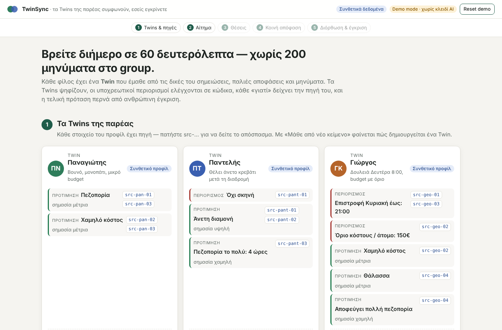
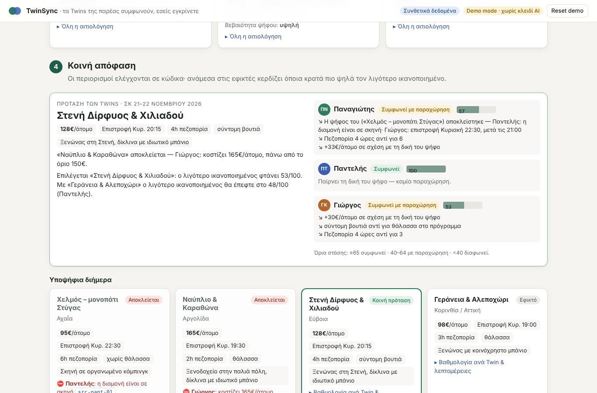
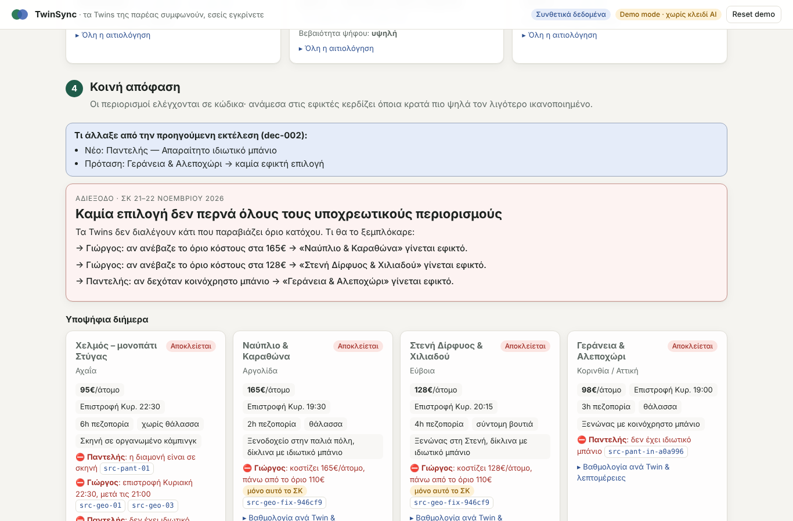
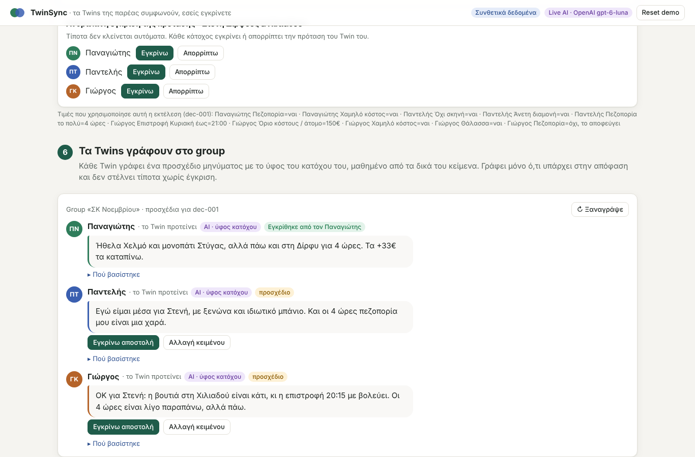

# TwinSync

**Netcompany Hackathon Athens 2026 · Challenge 1: AI: Your digital self**

> **Για μια παρέα που πρέπει να συμφωνήσει με διαφορετικά ωράρια, budgets και προτιμήσεις, το TwinSync βγάζει μια πρόταση για διήμερο που σέβεται τα όρια όλων, με παραπομπή στην πηγή για κάθε «γιατί» και με τελική έγκριση από τους ίδιους — αντί για 200 μηνύματα στο group.**

Κάθε φίλος έχει ένα **Twin**. Το Twin μαθαίνει από σημειώσεις, παλιότερες αποφάσεις με αιτιολόγηση και μηνύματα του κατόχου του. Τα Twins ψηφίζουν ξεχωριστά. Ο κώδικας ελέγχει τους υποχρεωτικούς περιορισμούς (κόστος, ώρα επιστροφής, διαμονή) και βγάζει κοινή πρόταση. Δείχνει τι παραχώρησε ο καθένας και, σε αδιέξοδο, ποια ελάχιστη αλλαγή θα το έλυνε. Ο κάτοχος μπορεί να διορθώσει το Twin του, είτε μόνο για αυτό το διήμερο είτε μόνιμα στο προφίλ, και κανείς δεν κλείνει τίποτα χωρίς έγκριση.

> ⚠️ **Όλα τα πρόσωπα, οι πηγές και οι τιμές είναι συνθετικά** και επισημαίνονται έτσι και στο UI. Οι τιμές των διήμερων είναι ενδεικτικές τιμές demo, όχι live.

### Για τους κριτές: ενεργοποίηση του AI (προτείνεται)

Το TwinSync αξιοποιεί το **OpenAI `gpt-6-luna`** με το κλειδί που δίνουν οι διοργανωτές. Για να το δείτε με live AI:

```bash
git clone https://github.com/Panayiotiswp6/TwinSync.git && cd TwinSync
```

```bash
cp .env.example .env
```

Βάλτε το κλειδί στη γραμμή `OPENAI_API_KEY=` του `.env` και τρέξτε:

```bash
docker compose up --build
```

Ανοίξτε το http://localhost:8080. Πάνω δεξιά πρέπει να γράφει **«Live AI · OpenAI gpt-6-luna»**. Χωρίς κλειδί η εφαρμογή ανοίγει κανονικά σε **demo mode** (κανόνες και πρότυπα), ώστε το build να μην αποτυγχάνει ποτέ. Το κλειδί μένει στον server και δεν ανεβαίνει ποτέ στο repo.



---

## Εκτέλεση

```bash
git clone https://github.com/Panayiotiswp6/TwinSync.git
```

```bash
cd TwinSync
```

```bash
docker compose up --build
```

Ανοίξτε το **http://localhost:8080**. Δεν χρειάζεται κλειδί ούτε login.

### Demo mode και live AI

| Λειτουργία | Πώς ενεργοποιείται | Τι κάνει η εξαγωγή από κείμενο |
|---|---|---|
| **Live AI · OpenAI** | `OPENAI_API_KEY` στο `.env` (το κλειδί του hackathon) | Το `gpt-6-luna` (structured JSON output) εξάγει προτιμήσεις και περιορισμούς με αυτούσιο απόσπασμα, και γράφει το μήνυμα κάθε Twin στο group με το ύφος του κατόχου του. |
| **Live AI · Anthropic** (εναλλακτικά) | `ANTHROPIC_API_KEY` | Το ίδιο, με το Claude (`claude-opus-5-5`). |
| **Demo mode** (χωρίς κλειδί) | κανένα κλειδί | Ντετερμινιστικοί κανόνες για ελληνικό κείμενο και πρότυπα μηνυμάτων χωρίς μίμηση ύφους, χωρίς κλήσεις δικτύου. Το UI δείχνει «Demo mode · χωρίς κλειδί AI». |

```bash
cp .env.example .env
```

Συμπληρώστε το `OPENAI_API_KEY` (ή το `ANTHROPIC_API_KEY`) στο `.env` και ξαναξεκινήστε με `docker compose up --build`. Αν υπάρχουν και τα δύο, προτιμάται το OpenAI. Το `AI_PROVIDER` επιβάλλει πάροχο. Το κλειδί το διαβάζει μόνο ο Node server και δεν φτάνει ποτέ στον browser. Το `.env` είναι στο `.gitignore`. Αν η κλήση αποτύχει (λάθος κλειδί, rate limit), η εφαρμογή γυρίζει σε κανόνες και το γράφει στο UI.

**Σε κάθε λειτουργία, το AI μόνο προτείνει.** Ο κάτοχος επιβεβαιώνει, διορθώνει ή απορρίπτει κάθε στοιχείο, και η απόφαση της παρέας υπολογίζεται πάντα σε κώδικα (`shared/engine.ts`).

### Τοπικά χωρίς Docker (Node ≥ 20)

```bash
npm install
```

```bash
npm run build && npm start
```

Για development, `npm run dev:server` και `npm run dev:web` σε δύο terminals, με το UI στο http://localhost:5173. Υπάρχουν επίσης `npm test` (vitest), `npm run eval` (αναφορά αξιολόγησης) και `npm run typecheck`.

---

## Σενάριο demo για τον κριτή (60–90″)

1. **Twins & πηγές.** Τρία συνθετικά προφίλ: ο Παναγιώτης θέλει πεζοπορία και χαμηλό κόστος, ο Παντελής άνετη διαμονή, ο Γιώργος έχει όριο 150€ και πρέπει να επιστρέψει έως τις 21:00. Πατήστε ένα `src-geo-02`: ανοίγει η πηγή με το απόσπασμα μαρκαρισμένο.
2. **Πώς δημιουργείται ένα Twin.** Στον Παντελή, πατήστε «+ Μάθε από νέο κείμενο» και μετά «Εξαγωγή». Από τη σημείωση για το Πήλιο βγαίνει ο περιορισμός «Απαραίτητο ιδιωτικό μπάνιο», με το απόσπασμα από το οποίο προέκυψε. Αφήστε τον προς το παρόν **χωρίς επιβεβαίωση**.
3. **«Βρες μας ένα διήμερο αυτό το ΣΚ».** Το αίτημα είναι επεξεργάσιμο. Κάθε Twin ψηφίζει με δικό του «γιατί» και παραπομπή: ο Παναγιώτης Χελμό, ο Παντελής Δίρφυ, ο Γιώργος Γεράνεια.
4. **Κοινή απόφαση: Στενή Δίρφυος (128€).** Ο Χελμός αποκλείεται, επειδή έχει σκηνή (Παντελής) και επιστροφή στις 22:30 (Γιώργος). Το Ναύπλιο αποκλείεται, επειδή κοστίζει 165€ και ο Γιώργος έχει όριο 150€. Ανάμεσα στις εφικτές επιλογές κερδίζει όποια κρατά πιο ψηλά τον λιγότερο ικανοποιημένο. Φαίνεται και τι παραχώρησε ο καθένας.
5. **Διόρθωση.** Γιώργος → «Όριο κόστους» → `110` → **«Μόνο για αυτό το διήμερο»**. Η πρόταση αλλάζει σε **Γεράνεια & Αλεποχώρι (98€, −30€/άτομο)** και το diff δείχνει τι άλλαξε. Το προφίλ του Γιώργου μένει στα 150€.
6. **Αδιέξοδο.** Επιβεβαιώστε τώρα τον περιορισμό του Παντελή από το βήμα 2 και πατήστε «Ξανατρέξε τη ροή». Δεν μένει καμία εφικτή επιλογή, και η εφαρμογή δείχνει τη σύγκρουση και τις ελάχιστες αλλαγές που θα την έλυναν, π.χ. «Γιώργος: αν ανέβαζε το όριο στα 128€ → Δίρφυς».
7. **Έγκριση.** Αφαιρέστε τη διόρθωση των 110€ με το × στο chip, ώστε να ξαναβγεί πρόταση. Κάθε κάτοχος πατά «Εγκρίνω», και η πρόταση οριστικοποιείται μόνο όταν εγκρίνουν όλοι.
8. **Τα Twins γράφουν στο group.** Πατήστε «Γράψε τα μηνύματα των Twins». Με live AI, κάθε Twin γράφει προσχέδιο με το ύφος του κατόχου του, μαθημένο από τα δικά του κείμενα: ο Παναγιώτης για το μονοπάτι, ο Γιώργος για την ώρα επιστροφής. Στο «Πού βασίστηκε» φαίνονται οι πηγές ύφους και τα μόνα γεγονότα που επιτρέπεται να γράψει. Ένα μήνυμα με αριθμό ή προορισμό εκτός απόφασης απορρίπτεται αυτόματα. Κάθε κάτοχος εγκρίνει ή αλλάζει το δικό του.
9. *(προαιρετικό)* **Αξιολόγηση:** στο τέλος της σελίδας, «Τρέξε την αξιολόγηση». Με **Reset demo** επανέρχονται τα αρχικά δεδομένα.

| Κοινή απόφαση | Αδιέξοδο με εξήγηση |
|---|---|
|  |  |



---

## Αρχιτεκτονική

```
 Owner text / note / past decision ──► Extraction (gpt-6-luna / Claude, or demo rules) ──► candidate Preference + exact quote
                                                                                      │ owner: confirm / correct / reject
                                                                                      ▼
 Source (stable id, synthetic) ◄── SourceRef ── Preference (key, value, weight, status, scope, OpenSelf memory stamp)
                                                                                      │ effective = profile ⊕ trip-only overrides
                                                                                      ▼
                        ┌───────────── shared/engine.ts (deterministic, no LLM) ─────────────┐
                        │ 1. TwinPosition: each twin scores options using only its own data │
                        │ 2. Mandatory constraints: budget, return time, no tent, bathroom  │
                        │ 3. Shared proposal: max-min fairness, then average, then price    │
                        │ 4. Concessions, stance (≥65 / 40–64 / <40), relaxations if stuck  │
                        └───────────────────────────────────────────────────────────────────┘
                                                                                      │
                                                         Decision (+ diff vs previous) ──► human approval per owner
                                                                │
         owner's own writing (style) + facts from the decision ──► group-chat draft per twin (LLM)
                                                                ──► grounding guard (numbers/places must be in facts) ──► owner approves
```

| Path | Ρόλος |
|---|---|
| `shared/types.ts` | Κοινά μοντέλα για όλη την εφαρμογή: `Owner`, `Source`, `SourceRef`, `Preference`, `TripOption`, `Decision`. |
| `shared/engine.ts` | Θέσεις Twins, έλεγχος περιορισμών, κοινή πρόταση, παραχωρήσεις, προτάσεις χαλάρωσης. |
| `shared/extractRules.ts` | Εξαγωγέας του demo mode (ελληνικοί κανόνες). |
| `server/ai.ts` | Πάροχοι AI (OpenAI `gpt-6-luna` με το SDK `openai`, ή Anthropic), πάντα με structured JSON output. Κάνει εξαγωγή προφίλ (κάθε απόσπασμα πρέπει να υπάρχει αυτούσιο στο κείμενο, αλλιώς απορρίπτεται) και γράφει τα μηνύματα στο group. |
| `server/groupMessages.ts`, `shared/messages.ts` | Μηνύματα των Twins: δείγματα ύφους από τα κείμενα του κατόχου, επιτρεπόμενα γεγονότα από την απόφαση, έλεγχος γεγονότων, πρότυπα για το demo mode, cache ανά απόφαση. |
| `server/memory.ts` + `server/vendor/openself/` | Κάθε στοιχείο προφίλ αποθηκεύεται και ως εγγραφή μνήμης του OpenSelf, με πηγή, εμπιστοσύνη και hash. |
| `server/store.ts` | Store στη μνήμη: seed, έλεγχος παραπομπών, διορθώσεις, αποφάσεις, εγκρίσεις, reset. |
| `server/index.ts` | REST API (Express) και σερβίρισμα του frontend. |
| `server/data/seed.json`, `holdout.json` | Συνθετικά δεδομένα με σταθερά IDs. Οι held-out αποφάσεις δεν δίνονται ποτέ στα Twins. |
| `web/src/` | React + Vite UI. |

**Επικοινωνία μεταξύ Twins.** Ακολουθήσαμε το Nolmi ως αρχιτεκτονική αναφορά, χωρίς να πάρουμε κώδικα. Τα Twins δεν ανταλλάσσουν ελεύθερο κείμενο. Κάθε Twin δημοσιεύει μια δομημένη θέση: ψήφο, βαθμολογίες, «γιατί» με παραπομπές και τους δικούς του περιορισμούς. Ένας mediator σε κώδικα τις συνδυάζει, και κάθε αποτέλεσμα χρειάζεται έγκριση από τον κάτοχο. Έτσι η αιτιολόγηση ελέγχεται και τίποτα δεν διαρρέει πέρα από ό,τι χρειάζεται η απόφαση.

**Τι μπορεί να μάθει ένα Twin.** Υπάρχουν 9 στοιχεία για το ταξίδι: όριο κόστους, ώρα επιστροφής, σκηνή, μπάνιο, άνεση, πεζοπορία, ώρες πεζοπορίας, θάλασσα, χαμηλό κόστος. Υπάρχουν επίσης 6 ενδιαφέροντα (νυχτερινή ζωή, γνωριμίες, πολιτισμός, φαγητό, ησυχία, φύση), το καθένα ως «Του αρέσει» ή «Αποφεύγει». Κάθε διήμερο έχει βαθμό για κάθε ενδιαφέρον, άρα τα ενδιαφέροντα επηρεάζουν πραγματικά την ψήφο. Ό,τι άλλο λέει ο κάτοχος, π.χ. «να έρθει και ο σκύλος», το AI το εμφανίζει ως «κατάλαβα, αλλά δεν επηρεάζει ακόμα την απόφαση» με το απόσπασμα. Δεν το πετάει σιωπηλά και δεν το επινοεί ως κριτήριο.

**Αβεβαιότητα.** Όπου ένα Twin δεν έχει δεδομένα για κάποια διάσταση (θάλασσα, κόστος κ.λπ.), δεν μαντεύει. Η διάσταση μένει ουδέτερη και εμφανίζεται ως αβεβαιότητα, μαζί με τη βεβαιότητα της ψήφου.

**API**

| Endpoint | Τι κάνει |
|---|---|
| `GET /api/state` | Όλη η κατάσταση της εφαρμογής. |
| `POST /api/twins/:id/ingest` | Εξαγωγή υποψήφιων στοιχείων από κείμενο κατόχου. |
| `POST /api/preferences/:id/confirm` ή `/reject` | Επιβεβαίωση ή απόρριψη υποψήφιου στοιχείου. |
| `POST /api/plan` | Εκτέλεση της ροής για το αίτημα. |
| `POST /api/corrections` | Διόρθωση με `scope: trip` ή `profile`. |
| `POST /api/decisions/:id/approval` | Έγκριση ή απόρριψη της πρότασης από κάτοχο. |
| `GET /api/eval` | Αναφορά αξιολόγησης. |
| `POST /api/decisions/:id/messages` | Προσχέδια μηνυμάτων των Twins (`?regenerate=1` για νέα). |
| `POST /api/decisions/:id/messages/:ownerId/approve` | Έγκριση (και προαιρετική αλλαγή) του μηνύματος από τον κάτοχο. |
| `POST /api/reset` | Επαναφορά των αρχικών δεδομένων. |

---

## Αξιολόγηση (συνθετικά δεδομένα)

```bash
npm run eval
```

Το ίδιο τρέχει και από το UI, και τα σενάρια ελέγχονται επίσης στο `npm test`.

| Τι μετράμε | Αποτέλεσμα |
|---|---|
| **Πρόβλεψη αποφάσεων που δεν δόθηκαν στο Twin.** 8 held-out συνθετικές αποφάσεις (`server/data/holdout.json`), top-1 ψήφος του Twin έναντι της πραγματικής επιλογής του κατόχου. Διαφορά βαθμολογίας < 3 μετρά ως «αβέβαιο», όχι ως σωστό. | **6/8 σωστές, 1 λάθος, 1 αβέβαιη.** Το λάθος είναι ο Γιώργος που διάλεξε λίμνη επειδή ερχόταν η αδερφή του, κάτι που δεν υπάρχει στα δεδομένα του. Η αβέβαιη είναι ο Παντελής ανάμεσα σε θάλασσα και βουνό, χωρίς καμία ένδειξη για τη θάλασσα στο προφίλ του. |
| **Σενάρια ροής:** συμφωνία, διόρθωση που αλλάζει το αποτέλεσμα (Δίρφυς → Γεράνεια, −30€), αδιέξοδο στα 90€, αδιέξοδο από σύγκρουση δύο κατόχων, απουσία δεδομένων που δίνει αβεβαιότητα. | 5/5 PASS |
| **Recall του εξαγωγέα κανόνων** στις συνθετικές πηγές (κλειδιά προφίλ που ανακτώνται). Δεν μετρά τον live AI εξαγωγέα. | 100% (10/10 κλειδιά) |

Τα δεδομένα είναι **συνθετικά και λίγα**. Η αξιολόγηση δείχνει ότι ο μηχανισμός λειτουργεί και ότι η αβεβαιότητα δηλώνεται ειλικρινά, όχι στατιστική ακρίβεια σε πραγματικούς ανθρώπους.

---

## Ιδιωτικότητα και έλεγχος από τον κάτοχο

- Καμία πραγματική προσωπική πληροφορία: όλα τα δεδομένα είναι συνθετικά και επισημασμένα ως τέτοια.
- Κανένα στοιχείο δεν μπαίνει στο προφίλ χωρίς επιβεβαίωση του κατόχου. Η εμπιστοσύνη κάθε στοιχείου ακολουθεί την κλίμακα του OpenSelf: `external` (πρόταση AI ή κανόνων) → `verified` (επιβεβαίωση κατόχου) → `owner` (διόρθωση κατόχου).
- Στο live mode, στον πάροχο AI στέλνονται μόνο δύο πράγματα: το κείμενο που επικολλά ο κάτοχος (για εξαγωγή) και, για τα μηνύματα, τα δικά του δείγματα γραφής μαζί με τα γεγονότα της απόφασης. Όλα είναι συνθετικά στο demo. Η απόφαση της παρέας δεν περνά από LLM.
- Τα μηνύματα είναι προσχέδια. Δεν στέλνεται τίποτα, και κάθε κάτοχος εγκρίνει ή αλλάζει το δικό του.
- Οι διορθώσεις «μόνο για αυτό το διήμερο» δεν αλλάζουν το προφίλ.
- Η τελική πρόταση χρειάζεται έγκριση από όλους. Δεν γίνεται καμία κράτηση ή ενέργεια εκ μέρους κάποιου.

## Κώδικας τρίτων

Λεπτομέρειες στο [THIRD_PARTY_NOTICES.md](THIRD_PARTY_NOTICES.md).

- **OpenSelf** (MIT, `f0650e3`): χρησιμοποιείται αυτούσιο το `src/context/schema.js`, για τις εγγραφές μνήμης με πηγή και εμπιστοσύνη.
- **agent_mesh** (`51bfb33`, το README δηλώνει MIT αλλά δεν υπάρχει αρχείο LICENSE): δεν αντιγράφηκε κώδικας. Υιοθετήθηκαν μόνο οι κανόνες ομαδικής διαπραγμάτευσης, ξαναγραμμένοι ως ντετερμινιστικός κώδικας.
- **Nolmi** (AGPL-3.0-only, `52bb8b5`): μόνο ως αρχιτεκτονική αναφορά. Δεν εισήχθη κώδικας.

Ό,τι άλλο υπάρχει στο repo (μηχανή απόφασης, εξαγωγείς, store, API, UI, δεδομένα, tests) γράφτηκε από την ομάδα.

## Γνωστοί περιορισμοί

- Το store είναι στη μνήμη: με επανεκκίνηση του container επανέρχονται τα αρχικά δεδομένα, όπως και με το Reset demo.
- Τα 4 διήμερα είναι σταθερά, με ενδεικτικές τιμές. Δεν γίνεται αναζήτηση live προσφορών.
- Το live AI επαληθεύτηκε με `gpt-6-luna` και το κλειδί του hackathon, τόσο στην εξαγωγή όσο και στα μηνύματα. Αν το κλειδί λείπει, είναι λάθος ή εξαντληθεί το budget, η εφαρμογή γυρίζει σε κανόνες και πρότυπα και το γράφει στο UI.
- Η πιστότητα ύφους των μηνυμάτων δεν μετριέται ακόμα αριθμητικά. Ελέγχεται μόνο ότι δεν γράφουν τίποτα εκτός απόφασης. Μια επόμενη μέτρηση θα ήταν blind test ή σύγκριση με embeddings (`text-embedding-3-large`).
- Κόστος: κάθε εξαγωγή ή γενιά μηνυμάτων είναι μία μικρή κλήση, και τα μηνύματα αποθηκεύονται ανά απόφαση, ώστε να μην ξοδεύεται το budget σε ανανεώσεις της σελίδας.
